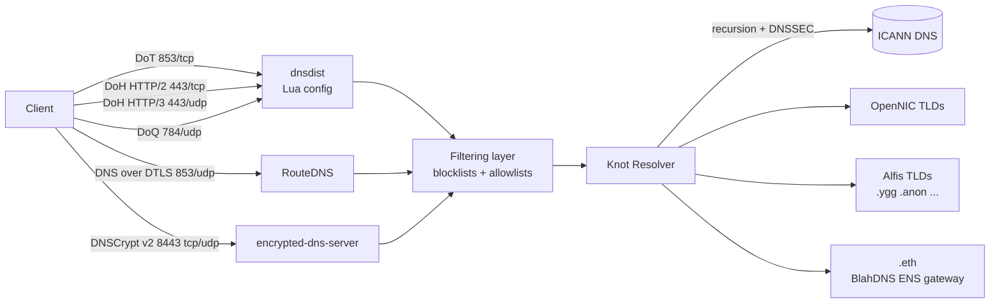

 

  &nbsp;&nbsp;
    All donations are welcome and any amount of money will help me to maintain this project 🥰 

 

## Repository moved

> The original GitHub account `zoonderkins`was suspended by GitHub, so `github.com/zoonderkins/blahdns` is no longer reachable.
> This project is now maintained at [github.com/fun-ed/blahdns](https://github.com/fun-ed/blahdns), re-published with the full commit history.
> Issues, gists, and stars from the old account could not be migrated.
>
> 原 GitHub 帳號 `zoonderkins`遭 GitHub 停權，原 repo 已無法存取；本專案改由 `fun-ed` 帳號重新公開，並保留完整 commit 歷史。舊帳號的 issues、gists 與 stars 無法搬移。

## Announcements

* `.eth` names work again through our own ENS gateway, and the Alfis TLDs are now resolved by our own Alfis node. (2026/10/14)
* Japan, Switzerland and Finland servers were discontinued on 2024-07-15; their old configs are in [Archived/legacy-servers](Archived/legacy-servers/README.md).
* DNS-over-HTTPS accepts POST requests only (RFC 8484 wire format). DNS-over-TLS is served on port 853 only. (2026/10/14)
* Our DNS service has been blocked due to Taiwan RPZ policy
* We had migrated SSL CA from Buypass GO to Google CA. (2025/09/27)
* We had migrated DNS Stack to Knot-resolver + dnsdist
* Beta support `alfis.name` tld. `.anon, .btn, .conf, .index, .merch, .mirror, .mob, .screen, .srv, .ygg`
* Old announcements were kept in issue #36 on the suspended `zoonderkins/blahdns` repository and are no longer available.

## Our features

* Block Trackers, Ads, Malwares, Phishing
* No ECS, DNSSEC ready, No logs, OpenNIC, Eth TLD, Yggdrasil 
* Support http://matoken.eth/ | http://mesh.ygg/ | http://i2pd.ygg/ | http://blahdns.oss/ | https://i❤.ws/
* BlahDNS status: [Status Page](https://stats.blahdns.com)

## How to setup / config DoH DoT Dnscrypt 👇
Config: [HERE for more details](https://github.com/fun-ed/blahdns/tree/master/server-conf)

## Server architecture

Every public resolver (Germany, Singapore) runs the same stack:

| Layer | Software | What it does |
|---|---|---|
| Encrypted frontends | [dnsdist](https://dnsdist.org/) (Lua config) | DNS-over-TLS on 853/tcp, DNS-over-HTTPS on 443 (HTTP/2 and HTTP/3, POST only), DNS-over-QUIC on 784/udp. Drops ANY and CHAOS queries, per-client rate limits, packet cache |
| | [RouteDNS](https://github.com/folbricht/routedns) | DNS over DTLS on 853/udp |
| | [encrypted-dns-server](https://github.com/DNSCrypt/encrypted-dns-server) | DNSCrypt v2 on 8443 tcp/udp |
| Filtering layer | blocklists + allowlists | Blocks trackers, ads, malware and phishing using the lists in [hosts/source.txt](hosts/source.txt) plus our own black/whitelists. Blocked names answer `0.0.0.0` / `::`. No query log |
| Recursive resolver | [Knot Resolver](https://github.com/CZ-NIC/knot-resolver) | Full recursion with DNSSEC validation, no ECS. Special zones below |

Special zones in the resolver:

* **OpenNIC TLDs** (`.oss`, `.geek`, ...): forwarded to OpenNIC.
* **Alfis TLDs** (`.anon .btn .conf .index .merch .mirror .mob .screen .srv .ygg`): resolved by our own [Alfis](https://github.com/Revertron/Alfis) node (blockchain DNS) in Germany; the Singapore resolver forwards these TLDs to Germany over DNS-over-TLS. These names are not DNSSEC-signed. Example: http://mesh.ygg/ (needs a [Yggdrasil](client-conf/yggdrasil.md) connection to open the site).
* **`.eth` (ENS)**: every `.eth` name resolves (A/AAAA only) to the BlahDNS ENS gateway. The gateway reads the name's ENS content hash from Ethereum and serves the IPFS site over plain HTTP, because no public CA issues certificates for `.eth`. Built on eth.limo's open-source [dweb-proxy-api](https://github.com/ethlimo/dweb-proxy-api) and IPFS [Rainbow](https://github.com/ipfs/rainbow). Example: http://matoken.eth/.

The DoT, DoH and DoQ endpoints are also reachable over the [Yggdrasil network](client-conf/yggdrasil.md).

## Config file / Client
* Collection of blocklist use in BlahDNS: [Source](https://github.com/fun-ed/blahdns/raw/master/hosts/source.txt) 
* Yggdrasil IPv6 Network: [Setup guide](https://github.com/fun-ed/blahdns/blob/master/client-conf/yggdrasil.md)
* Android DoH/DoT: [Nebulo App](https://play.google.com/store/apps/details?id=com.frostnerd.smokescreen) | [personalDNSfilter App](https://zenz-solutions.de/personaldnsfilter/) | [Intra](https://play.google.com/store/apps/details?id=app.intra)
* iOS Dnscryptv2/DoH: [Dnscloak](https://itunes.apple.com/app/dnscloak-secure-dns-client/id1452162351)
* Dnscryptv2: [dnscrypt-proxy](https://github.com/DNSCrypt/dnscrypt-proxy)
* Config files: [ Client config example ](https://github.com/fun-ed/blahdns/tree/master/client-conf)

## Awesome dns-resolver
The previous list was a gist on the suspended `zoonderkins` account and is no longer available.

## Huge thanks to those OSS and ORG
1. [Knot-resolver](https://github.com/CZ-NIC/knot-resolver)
2. [DNSPrivacy.org](https://dnsprivacy.org)

## Buy me some coffee :coffee: 

  
  
  &nbsp;&nbsp;
  

## DISCLAIMER
* This is a HOBBY service. The operator does not guarantee in any way the access, availability and continuity of the functioning of this service. 
* Use at your own risk. Under no circumstances will the operator be held responsible or liable in any way for any claims, damages, losses, expenses, costs or liabilities whatsoever (including, without limitation, any direct or indirect damages for loss of profits, business interruption or loss of information) resulting or arising directly or indirectly from accessing or otherwise using this service (Blahdns server).
* By using this website and service you consent to the disclaimer and agree to its terms and conditions.

